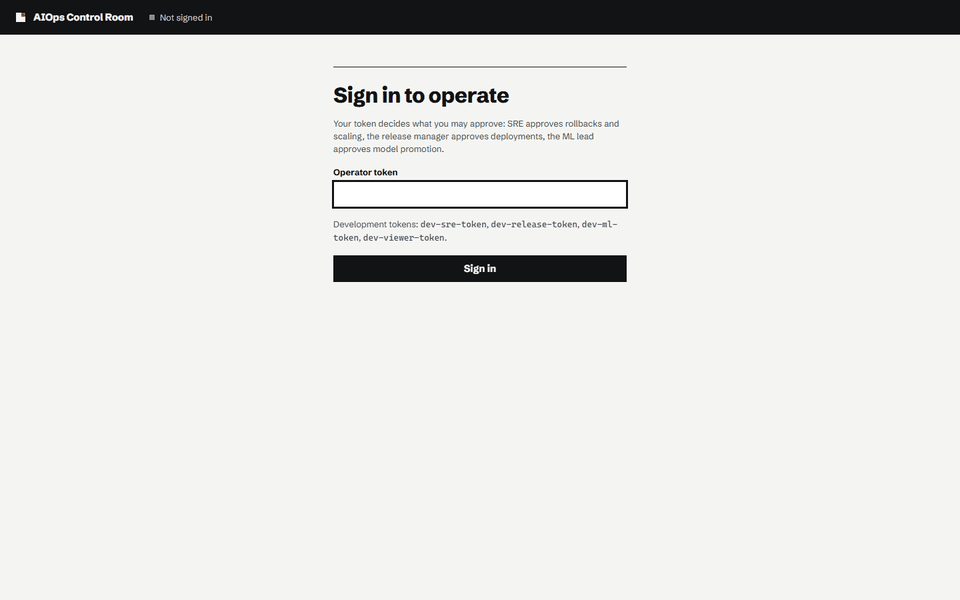
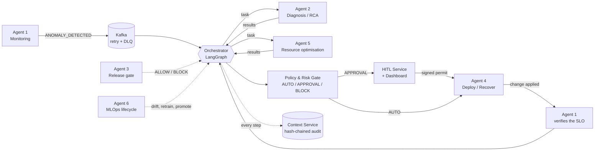

<div align="center">

# Six-Agent AIOps for a Fraud-Detection MLOps Service

**Six specialised agents detect, diagnose and repair incidents in a production ML service.<br>
A deterministic policy gate decides what may run on its own, and a human signs off on anything risky.**

[](https://github.com/Aymenrahmanii/Fraud_Detection_MLOps/actions/workflows/platform.yml)
[](https://github.com/Aymenrahmanii/Fraud_Detection_MLOps/actions/workflows/agent3-release-gate.yml)




</div>

## What it does

A fraud-detection model is served by FastAPI and tracked in MLflow. Around it, six agents and
a shared platform run a **closed loop**: *detect → diagnose → decide → approve → execute → verify → audit*.

- **Agents do the specialist work.** Monitoring, root-cause analysis, release gating, deployment and
  rollback, resource tuning and model retraining are each owned by one agent with one contract.
- **The platform keeps them safe.** A LangGraph orchestrator routes each incident over Kafka. A
  deterministic Policy & Risk Gate classifies every action as `AUTO`, `APPROVAL` or `BLOCK`. Agent 4
  changes nothing without an Ed25519-signed permit bound to the exact patch a human approved.
- **Nothing counts as fixed until it is verified.** Agent 1 independently checks the SLO after every
  change, and each step is appended to a hash-chained audit trail in the Context Service.

## See it run

The operator Dashboard handling the flagship scenario: a memory leak introduced by `payment-service v2.7`.
The SRE sees the exact image-digest rollback, approves it, and Agent 1 verifies the recovery.

<p align="center">
  
</p>

## Quick start

```bash
git clone https://github.com/Aymenrahmanii/Fraud_Detection_MLOps.git
cd Fraud_Detection_MLOps
# install every agent + platform dependency in one env: see "Installing everything" in aiops_platform/README.md

python -m aiops_platform.demo --auto       # every scenario end to end, no Docker
python -m aiops_platform.demo serve        # Dashboard on http://127.0.0.1:8090 (token: dev-sre-token)
docker compose -f compose.platform.yaml up --build -d   # distributed stack: Redpanda, Postgres, Redis, gRPC
```

Run the platform tests with `python -m pytest -q -W ignore aiops_platform/tests`. Benchmarks, Grafana and the
chaos experiments are described in [aiops_platform/TESTING.md](aiops_platform/TESTING.md).

## Architecture



| Agent | Responsibility | Docs |
|---|---|---|
| **1 · Monitoring** | Watches services through Prometheus and Loki, raises anomalies, and verifies recovery after a fix | [agent1_monitoring](agent1_monitoring/README.md) |
| **2 · Diagnosis** | Root-cause analysis over Kubernetes history, logs and a RAG knowledge base | [agent2_diagnosis](agent2_diagnosis/README.md) |
| **3 · Security & quality** | Release gate in CI: tests, gitleaks secret scan, Trivy image scan and policy, returning `ALLOW` or `BLOCK` | [agent3_security_quality](agent3_security_quality/) |
| **4 · Deployment & recovery** | Pre-flight checks, dry runs, and only the approved patch, under a signed permit | [agent4_deployment_recovery](agent4_deployment_recovery/README.md) |
| **5 · Resource optimisation** | Deterministic, bounded scaling and memory recommendations | [agent5_resource_optimization](agent5_resource_optimization/README.md) |
| **6 · MLOps lifecycle** | Drift and quality checks, retraining, champion/challenger comparison, MLflow registry | [agent6_mlops_lifecycle](agent6_mlops_lifecycle/README.md) |
| **Shared platform** | Orchestrator, Kafka backbone, Context Service, policy gate, HITL, Dashboard | [aiops_platform](aiops_platform/README.md) |

### Scenarios covered by the demo

| Scenario | What happens |
|---|---|
| Memory leak after a deploy (production) | RCA finds the rollout; the gate asks a human; Agent 4 rolls back to the previous image digest; Agent 1 verifies |
| CPU saturation (staging) | A bounded scale-up is `AUTO`, so no human is needed |
| Release with a failing test | Agent 3 returns `BLOCK` and the release stops |
| Release after the fix | `ALLOW`, then approval, deploy and verification |
| Data drift | Agent 6 retrains, compares the candidate with the champion, registers it, and the ML lead reviews the promotion |
| Duplicate delivery, rejection, wrong approver, stale plan | Covered by tests: no second side effect, replan without executing, 403, Agent 4 refusal |

## Repository layout

```
aiops_platform/        shared platform: orchestrator, bus, context, policy, hitl, dashboard, sim
agent1_monitoring/ … agent6_mlops_lifecycle/    the six agents, each self-contained with its own tests
API/  Src/  Pages/  app.py                      the fraud-detection service (FastAPI, model, Streamlit)
compose.platform.yaml  proto/  K8s/  docker/    deployment: Compose stack, gRPC contracts, manifests
```

---

## The fraud-detection service

The system is built on top of the fraud-detection pipeline below, forked from
[MohitGupta0123/Fraud_Detection_MLOps](https://github.com/MohitGupta0123/Fraud_Detection_MLOps).
Its original documentation follows. The upstream author's live Streamlit demo of the base model is at
[frauddetectionmlops.streamlit.app](https://frauddetectionmlops.streamlit.app/).

### **Table of Contents**

1. [Project Overview](#1-project-overview)
2. [Tech Stack](#2-tech-stack)
3. [Architecture Diagrams](#3-architecture-diagrams)
4. [Features](#4-features)
5. [Directory Structure](#5-directory-structure)
6. [Setup Instructions](#6-setup-instructions)
7. [Running the Streamlit App](#7-running-the-streamlit-app)
8. [Running the FastAPI Service](#8-running-the-fastapi-service)
9. [Experiment Tracking with MLflow](#9-experiment-tracking-with-mlflow)
10. [Monitoring with Prometheus & Grafana](#10-monitoring-with-prometheus--grafana)
11. [Model Details](#11-model-details)
12. [Results & Metrics](#12-results--metrics)
13. [Screenshots](#13-screenshots)

### **1. Project Overview**

#### **Objectives**

* This project implements a **complete MLOps pipeline** for **fraud detection** using transactional data. It covers the **entire ML lifecycle**
* Build a modular **FraudPipeline** capable of feature engineering, preprocessing, resampling (SMOTE), and threshold tuning.
* Track experiments using **MLflow** for reproducibility and comparative analysis.
* Deploy the model using **FastAPI** for REST API services and **Streamlit** for an interactive UI.
* Containerize and orchestrate services using **Docker** and **Kubernetes (Minikube)**.
* Monitor system health and metrics using **Prometheus** and **Grafana** dashboards.

#### **Goal** 

Detect fraudulent transactions in real-time with **high recall** while minimizing false positives.

---

### **2. Tech Stack**

#### **Languages**

* **Python 3.12+**

#### **Core ML & Data Libraries**

* **Scikit-learn**: Model building, preprocessing, metrics.
* **Imbalanced-learn**: SMOTE for class imbalance handling.
* **Pandas / NumPy**: Data manipulation and numerical operations.

#### **MLOps & Deployment Tools**

* **MLflow**: Experiment tracking, logging metrics, model registry.
* **FastAPI**: Serving the fraud detection model via REST API.
* **Streamlit**: Interactive web UI for predictions and model insights.
* **Docker**: Containerization of the FastAPI and Streamlit apps.
* **Kubernetes (Minikube)**: Local orchestration and scaling of microservices.

#### **Monitoring Tools**

* **Prometheus**: Metrics scraping for FastAPI endpoints.
* **Grafana**: Visualization dashboards for system and API monitoring.

---

### **3. Architecture Diagrams**

#### **MLOps Pipeline**

The complete pipeline involves:

1. **Data Ingestion & Preprocessing**
2. **Model Training & Threshold Optimization**
3. **Experiment Tracking with MLflow**
4. **Model Deployment via FastAPI & Streamlit**
5. **Containerization with Docker**
6. **Orchestration using Kubernetes (Minikube)**
7. **Monitoring using Prometheus + Grafana**


---

#### **Model Pipeline**

1. **Feature Engineering**: Interaction, ratio, binning, time-of-day categorization.
2. **Preprocessing**: Imputation, encoding, log transform, scaling.
3. **Resampling**: SMOTE to address class imbalance.
4. **Model Training**: Logistic Regression (configurable to RandomForest/XGBoost).
5. **Threshold Tuning**: Optimize precision-recall trade-off for fraud detection.


---

### **4. Features**

* **Real-Time Fraud Prediction**:

  * Streamlit UI for quick predictions.
  * FastAPI endpoint for programmatic integration.

* **Experiment Tracking**:

  * MLflow logs parameters, metrics, artifacts (confusion matrix, PR curve).

* **Scalable Deployment**:

  * Dockerized microservices deployed on Kubernetes (Minikube).

* **Robust Monitoring**:

  * Prometheus scrapes real-time metrics from FastAPI.
  * Grafana dashboards visualize system health and request patterns.

* **Data Handling**:

  * Automatic preprocessing (missing values, scaling, encoding).
  * SMOTE resampling for highly imbalanced fraud datasets.

* **Threshold Optimization**:

  * Dynamically finds the best threshold balancing recall and precision.

### **5. Directory Structure**

The project follows a modular structure separating API, model, monitoring, and visualization components:

```
FRAUD_MLOPS_PROJECT/
│
├── API/                         # FastAPI microservice
│   ├── main.py                   # API entry point
│   ├── schemas.py                # Pydantic models for request/response
│   ├── services.py               # Core service logic
│   └── mlruns/                   # MLflow experiment tracking logs
│
├── Data/                         # Datasets
│   ├── payment_fraud.csv
│   └── combined_holdout.csv
│
├── Images/                       # Project diagrams & screenshots
│   ├── Docker/
│   ├── FastAPI/
│   ├── Grafana/
│   ├── MLFlow/
│   ├── MLOps_Architecture/
│   ├── Model_Architecture/
│   └── Prometheus/
│
├── K8s/                          # Kubernetes manifests
│   ├── fraud-api-deployment.yaml
│   ├── fraud-api-service.yaml
│   ├── grafana-deployment.yaml
│   └── prometheus-deployment.yaml
│
├── Notebooks/                    # Jupyter Notebooks
│   ├── EDA.ipynb
│   ├── training_model.ipynb
│   ├── test_files.ipynb
│   └── artifacts/                # Trained model artifacts
│       ├── confusion_matrix.png
│       ├── pr_curve.png
│       └── fraud_pipeline_deployed.pkl
│
├── Pages/                        # Streamlit multi-page app
│   ├── home.py
│   ├── about_model.py
│   ├── metrics_page.py
│   └── about_me.py
│
├── Src/                          # Core ML pipeline code
│   ├── model.py                   # FraudPipeline, FeatureEngineering, Preprocessing
│   ├── utils.py                   # Helper functions
│   ├── config.py                  # Configurations
│   └── artifacts/                 # MLflow model logs
│
├── app.py                         # Streamlit entry point
├── Dockerfile                      # Docker setup for Streamlit/FastAPI
├── requirements.txt                # Dependencies
├── .gitignore
└── README.md
```

---

### **6. Setup Instructions**

#### **Prerequisites**

* Python 3.10 or higher
* Docker Desktop
* Minikube (for Kubernetes)
* kubectl CLI
* Prometheus & Grafana (installed via Helm or K8s manifests)

---

#### **Local Development Setup**

1. **Clone the repository**

```bash
git clone https://github.com/Aymenrahmanii/Fraud_Detection_MLOps.git
cd Fraud_Detection_MLOps
```

2. **Create virtual environment & install dependencies**

```bash
python -m venv .venv
source .venv/bin/activate    # Linux/Mac
.venv\Scripts\activate       # Windows
pip install -r requirements.txt
```

3. **Run Streamlit app locally**

```bash
streamlit run app.py
```

4. **Run FastAPI service locally**

```bash
cd API
uvicorn main:app --reload --host 0.0.0.0 --port 8000
```

---

#### **Docker Setup**

1. **Build Docker images**

```bash
docker build -t fraud-streamlit -f Dockerfile .
docker build -t fraud-fastapi -f Dockerfile ./API
```

2. **Run containers**

```bash
docker run -p 8501:8501 fraud-streamlit
docker run -p 8000:8000 fraud-fastapi
```

---

#### **Kubernetes Deployment (Minikube)**

1. **Start Minikube**

```bash
minikube start --driver=docker
```

2. **Apply Kubernetes manifests**

```bash
kubectl apply -f K8s/fraud-api-deployment.yaml
kubectl apply -f K8s/fraud-api-service.yaml
kubectl apply -f K8s/prometheus-deployment.yaml
kubectl apply -f K8s/grafana-deployment.yaml
```

3. **Access services**

```bash
minikube service fraud-api-service
minikube service prometheus -n monitoring
minikube service grafana -n monitoring
```

### **7. Running the Streamlit App**

The Streamlit app provides an interactive interface to test fraud detection predictions and visualize model metrics.

#### **Local Run**

```bash
streamlit run app.py
```

* Access at: `http://localhost:8501`

#### **Features**

* Input transaction details (Category, Payment Method, Account Age, etc.)
* Auto-fill examples for **Legitimate** and **Fraudulent** transactions
* Real-time prediction with threshold-based confidence
* Navigation to **About Model**, **Metrics**, and **About Me** pages

---

### **8. Running the FastAPI Service**

FastAPI serves the fraud prediction model as a REST API, useful for production-grade deployment and integration with external systems.

#### **Local Run**

```bash
cd API
uvicorn main:app --reload --host 0.0.0.0 --port 8000
```

* Access API docs at: `http://localhost:8000/docs`

#### **Key Endpoints**

* `POST /predict` – Accepts JSON payload and returns prediction
* `GET /health` – Health check endpoint

#### **Docker Run**

```bash
docker build -t fraud-fastapi -f Dockerfile ./API
docker run -p 8000:8000 fraud-fastapi
```

---

### **9. Experiment Tracking with MLflow**

MLflow is integrated to log experiments, parameters, metrics, and artifacts (PR curve, confusion matrix, models).

#### **Usage**

* Automatically tracks during training via `FraudPipeline`
* Logs include:

  * Parameters: Steps applied, resampling method, model type
  * Metrics: Accuracy, Precision, Recall, F1-score, PR-AUC
  * Artifacts: PR Curve, Confusion Matrix, Serialized Model

#### **Access MLflow UI**

```bash
mlflow ui
```

* Opens at `http://127.0.0.1:5000`
* Explore experiment runs and compare metrics visually

---

### **10. Monitoring with Prometheus & Grafana**

The deployed FastAPI service exposes metrics for Prometheus, visualized via Grafana dashboards.

#### **Prometheus**

* Scrapes FastAPI metrics (request counts, response latency, error rates)
* Runs on port **9090** in `monitoring` namespace

#### **Grafana**

* Visualizes Prometheus data using pre-built dashboards
* Runs on port **3000** in `monitoring` namespace
* Import your **saved JSON dashboard** via Grafana UI

#### **Steps to Access**

```bash
minikube service prometheus -n monitoring
minikube service grafana -n monitoring
```

### **11. Model Details**

The fraud detection model is built using a **custom pipeline** with multiple stages:

#### **Pipeline Steps**

1. **Feature Engineering**

   * Interaction: `Category x PaymentMethod`
   * Ratio: `paymentMethodAgeDays / accountAgeDays`
   * Binning: `accountAgeDays` into `new/medium/old`
   * Time Feature: Categorize `localTime` into time-of-day bins

2. **Preprocessing**

   * Imputation for missing values (median/mode)
   * One-hot encoding for categorical variables
   * Log transformation for skewed features
   * Scaling: StandardScaler (skewed) + MinMaxScaler (symmetric)

3. **Resampling**

   * **SMOTE** to handle extreme class imbalance

4. **Model Training**

   * Logistic Regression (default)
   * Supports other models like RandomForest, XGBoost

5. **Threshold Tuning**

   * Optimal threshold found via precision-recall curve
   * Current best threshold: **0.8370** (Precision = 0.955, Recall = 0.991)

---

### **12. Results & Metrics**

#### **Hold-out Set Performance**

* **Hold-out A**: Accuracy 97%, Recall 100%, Precision 25% (imbalanced case)
* **Hold-out B**: Accuracy 99%, Recall 100%, Precision 50% (imbalanced case)
* **Hold-out C**: Accuracy 98%, Recall 98%, Precision 98%

#### **PR Curve & Confusion Matrix**

* Stored in `Notebooks/artifacts/`
* PR Curve demonstrates strong precision-recall balance
* Confusion Matrix confirms minimal false negatives (critical for fraud detection)

---

### **13. Screenshots**

---

#### 1. **MLFlow**
- 
- 

---

#### 2. **Docker**
- 
- 
- 

---

#### 3. **FastAPI**
- 
- 
- 

---

#### 4. **Prometheus**
- 

---

#### 5. **Grafana**
- 
- 
- 
- 
- 

---

---

## Credits

- **Base fraud-detection service** (model, FastAPI, Streamlit, Docker/K8s, Prometheus/Grafana):
  [Mohit Gupta](https://github.com/MohitGupta0123), upstream of this fork.
- **Six agents and the shared platform**: the project team. See the
  [contributors](https://github.com/Aymenrahmanii/Fraud_Detection_MLOps/graphs/contributors).

Contributions are welcome: open an issue or a pull request. Every PR runs the CI gate of the area it touches.
