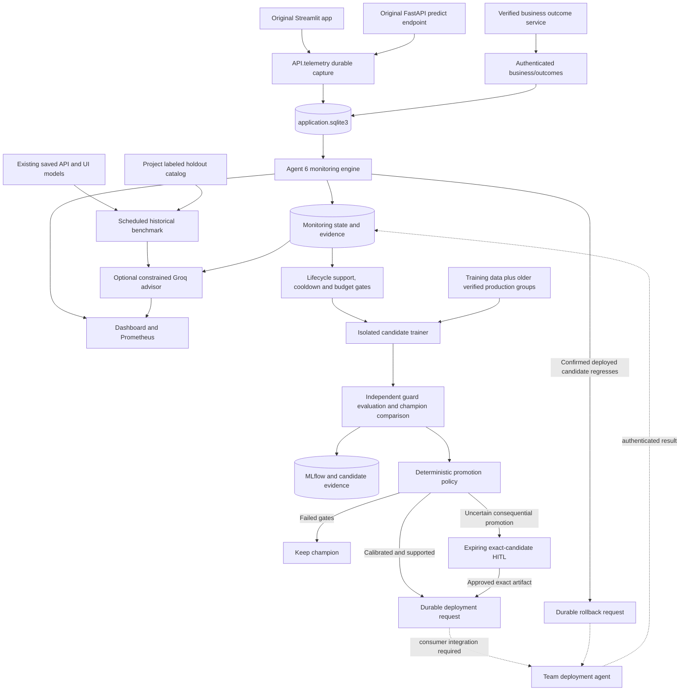
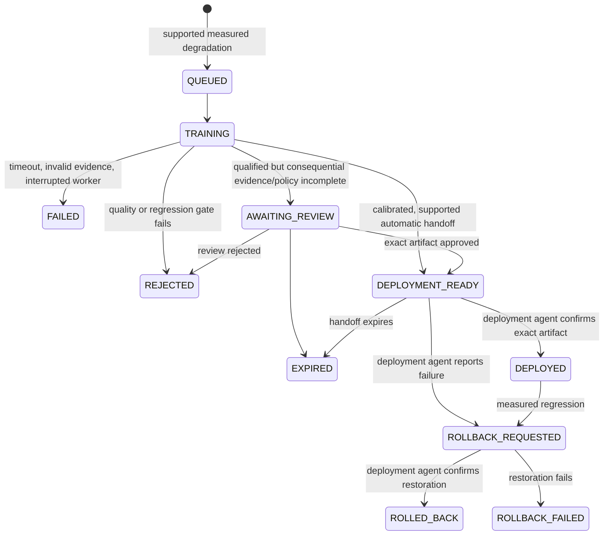

# Architecture and file responsibilities

## Runtime flow

## Package map

| Path | Responsibility |
| --- | --- |
| `__main__.py`, `cli/main.py` | One command surface: initialize, run, stop, diagnose, validate, and inspect |
| `runner.py`, `bootstrap.py`, `paths.py` | Own service processes; prepare private configuration and benchmark catalog; resolve the current checkout or installed wheel |
| `monitoring/engine.py` | Periodic observation, quality and operational assessments, references and alerts |
| `monitoring/source.py`, `outcome_feed.py` | Read application records and verified outcome feeds with scope/time boundaries |
| `monitoring/models.py`, `settings.py`, `state.py` | Validated monitoring contracts, thresholds, durable reports and checkpoints |
| `monitoring/app.py`, `metrics.py`, `web/` | Authenticated dashboard APIs, bounded metrics, static UI |
| `assurance/catalog.py`, `bootstrap.py` | Import historical labels and identify the actual saved artifacts |
| `assurance/service.py`, `worker.py`, `store.py` | Schedule real model benchmarks in compatible subprocesses; hash evidence and persist results |
| `assurance/advisor.py`, `prompts/` | Build evidence context with Jinja templates; constrain Groq output to eligible findings and citations |
| `fraud/models.py`, `metrics.py`, `service.py` | Typed fraud policy, confusion/error costs, Wilson intervals, probability ranking/calibration, subgroup evidence and business-ID deduplication |
| `lifecycle/service.py` | Automatic training triggers, evidence checks, candidate state machine and rollback requests |
| `lifecycle/data.py` | Stable feature identities and recent whole-group holdout partition |
| `lifecycle/worker.py`, `model.py` | Actual preprocessing, random forest fitting, threshold tuning, scoring, candidate serialization and MLflow registration |
| `lifecycle/policy.py` | Validate confusion counts and metrics; recompute promotion gates; require real supported evidence for auto handoff |
| `lifecycle/store.py` | Transactional scheduling, replay prevention, job limits, immutable review decisions |
| `lifecycle/api.py` | Exact-candidate HITL and separately authenticated deployment/rollback callbacks |
| `evaluation/`, `health/`, `ingestion/` | Reusable metric policies, LLM judges, health assessment and delayed-outcome joins |
| `storage/`, `contracts/`, `core/` | Agent 6's scoped persistence, versioned contracts and base abstractions |
| `validation.py`, `tests/` | Actual isolated model acceptance and unit/integration regression tests |
| `.env.example`, `config/` | Public configuration templates; actual `.env` is private and ignored |

Application hooks are confined to `API/telemetry/`, the original prediction endpoints in `API/main.py` and `API/services.py`, and prediction capture in `Pages/home.py`. API response predictions retain their existing JSON shape; `X-Observation-ID` and `X-Model-Version` link later confirmations. Streamlit's actual serialized model is monitored independently from the API's model.

## Data and model identities

Every prediction has its own observation ID. The model version is `artifact-<sha256>` of the actual saved artifact, rather than an arbitrary label such as `v1`. The tenant/project/model scope prevents unrelated streams from mixing. Source payloads and assessment evidence are hashed; a hash provides integrity and traceability, not proof that a business outcome is true.

Live capture uses SQLite, not recurring CSV exports. The existing training CSV supplies historical training examples; the historical holdout is imported into a separate immutable benchmark catalog. Those are different jobs from live event collection.

The retrainer uses validated seven-feature inputs, imputation, categorical one-hot encoding, a weighted random forest, and a threshold chosen on validation data. It excludes benchmark and recent live guard feature groups before the fit/validation split. A rounded numeric canonicalization treats floating-point CSV/JSON roundoff conservatively. Duplicate/conflicting labels fail preparation rather than silently contaminating the split.

Older verified groups can augment training. The latest complete feature groups remain a guard, including all repeats of those groups. The split manifest records hashed membership, source hash, and sample counts. Candidate evaluation records historical and recent scores, champion comparison, confusion counts, and a paired bootstrap interval for F1 improvement. An interval is statistical evidence conditional on this sample, not a calibrated probability that the whole model is correct.

## Lifecycle state machine

The LLM is outside the promotion state machine. Provider failure or an invalid answer does not stop measured monitoring and cannot authorize promotion. Routine work runs without a person; HITL applies to consequential exceptions. A lifecycle request is not evidence that a rollout occurred.

The [fraud evaluation extension](fraud-evaluation.md) documents transaction-ID correlation, final-event inbox/database readers, captured model probabilities, additive prediction schemas, and the diagnostic threshold explorer.
